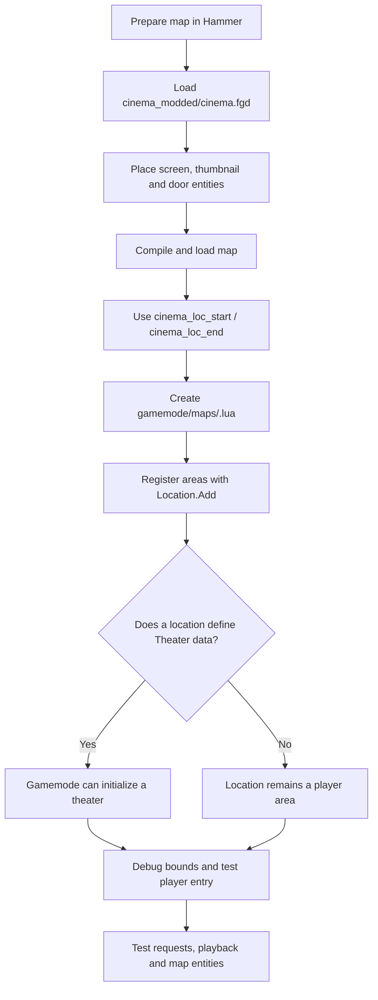

# Creating custom maps

This guide explains how to make a map compatible with Cinema (Fixed Edition) using Hammer entities and Lua location definitions.

## Requirements

- Hammer or another Source map editor.
- The repository's Cinema FGD: `cinema_modded/cinema.fgd`.
- Basic Garry's Mod Lua knowledge for location files.

## 1. Add the Cinema FGD to Hammer

Add `cinema_modded/cinema.fgd` to your Garry's Mod game configuration in Hammer. Restart Hammer if required.

The FGD defines Cinema entities including:

| Entity | Purpose |
|---|---|
| `theater_screen` | Fixed 3D2D theater screen |
| `theater_thumbnail` | Preview screen for current playback |
| `theater_door` | One-way teleport door |
| `theater_portable_tv` | Portable TV entity |
| `theater_portable_projector` | Portable projector entity |

Check the current FGD and entity definitions for available keyvalues.

## 2. Place theater entities

For `theater_screen`, place the screen origin at the intended top-left corner and orient it toward the audience. Configure its name, flags, dimensions, and optional thumbnail reference in Hammer.

Place `theater_thumbnail` separately and connect it using the supported targetname/keyvalue. For teleport doors, use the matching destination entity setup; a two-way route needs both directions configured.

Compile the map as usual.

## 3. Create location data

The gamemode also needs Lua location boxes to know where players are. The recommended workflow uses the in-game admin helpers:

1. Load the map with Cinema.
2. Noclip to one corner of the area.
3. Run `cinema_loc_start`.
4. Move to the opposite corner.
5. Run `cinema_loc_end`; the Lua snippet is printed and copied to the clipboard.
6. Replace the placeholder name and paste the result into the map's Lua file.

Use `cinema_loc_vector` to copy a position as a Lua `Vector(...)` expression.

Create a file named after the map at:

```text
cinema_modded/gamemode/maps/<mapname>.lua
```

Example:

```lua
Location.Add("mymap", {
    ["Lobby"] = {
        Min = Vector(-100, -200, 0),
        Max = Vector(100, 200, 200),
    },
    ["Private Theater #1"] = {
        Min = Vector(...),
        Max = Vector(...),
        Theater = {
            Name = "Private Theater 1",
            Flags = THEATER_PRIVATE,
            Pos = Vector(...),
            Ang = Angle(0, 180, 0),
            Width = 396,
            Height = 192,
        },
    },
})
```

See [Location system](location-system.md) for the complete location and theater data model.


## Mapping workflow

Hammer entities define physical screens and related map objects; the Lua location file defines player areas and connects theater metadata to those areas.



## 4. Standalone Workshop maps

If the map is distributed separately from the gamemode, ship a compatible Lua autorun file with the map/addon and ensure it loads after the Cinema Location module is available. Avoid relying on an unverified load order; test the registration on a clean server.

## 5. Testing checklist

1. Enable `cinema_debug_locations 1` and check every location box.
2. Enter each theater and confirm the correct name and queue appear.
3. Request a short supported URL and verify playback for multiple players.
4. Test thumbnails, doors, and portable entities used by the map.
5. Test private-theater ownership/renting if applicable.

## Example map files

Use the existing map definitions under `cinema_modded/gamemode/maps/` as references. The repository also includes `cinema_theatron.vmf` in the root.

## Common pitfalls

- Map names in `Location.Add` must match the actual map name.
- Location boxes should be tight and should not overlap unnecessarily.
- The screen origin and orientation must match the Hammer entity's expected geometry.
- Portable TVs/projectors are separate from fixed theater location registration.

## Related pages

- [Location system](location-system.md)
- [Debug commands](debug-commands.md)
- [Installation](installation.md)
