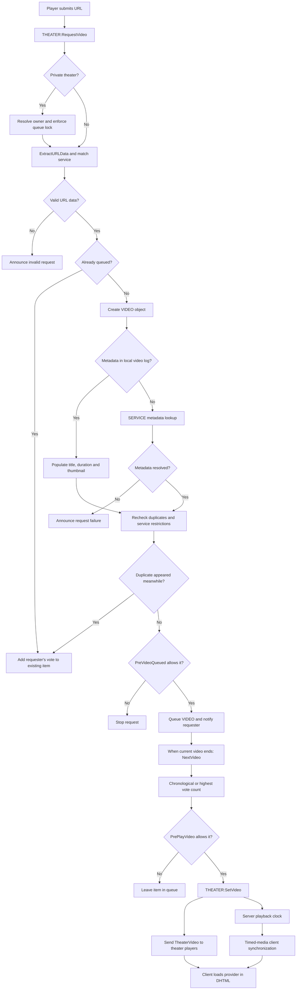

# Implementing a custom video service

Media services live under:

```text
cinema_modded/gamemode/modules/theater/services/
```

A service is a Lua table registered through the theater service registry. It matches URLs, extracts provider-specific data, retrieves metadata, and loads a client-side player.

## Architecture overview

```text
URL request
  -> URL extraction and service matching
  -> SERVICE:GetURLInfo()
  -> SERVICE:GetVideoInfo()
  -> VIDEO creation and queueing
  -> client SERVICE:LoadProvider()
  -> Cinema JavaScript controller bridge
```

The base service in `sh_base.lua` provides shared helpers. Read it and at least one existing service before implementing a new provider; provider requirements differ substantially.


## Request and playback flow

This follows the server's `THEATER:RequestVideo`, `VIDEO:RequestInfo`, and `THEATER:NextVideo` paths. Duplicate checks run both before and after asynchronous metadata resolution.



Provider implementations may perform additional checks or change the service type during metadata resolution; the server revalidates the resulting type before queueing.

## Implementation checklist

1. Create a service file in the appropriate subdirectory under `services/`.
2. Define the service metadata and register the service using the same pattern as neighboring services.
3. Implement URL matching and extraction. Reject unsupported URL shapes rather than guessing IDs.
4. Retrieve metadata using the project's existing HTTP/crawler helpers and call the success/failure callbacks consistently.
5. Implement client playback in `LoadProvider`, using the existing DHTML and JavaScript bridge.
6. Handle live streams, timed VOD, start times, unavailable content, and provider errors explicitly.
7. Test the service with multiple URL variants and more than one client.

## Core service methods

### `SERVICE:Match(url)`

Return a truthy value when the parsed URL belongs to the service. Keep matching inexpensive because services are checked for requests.

### `SERVICE:GetURLInfo(url)`

Return a table containing the stable service data and optional start time, or `false` if the URL is unsupported. Follow existing services for the exact accepted data shape.

### `SERVICE:GetVideoInfo(data, onSuccess, onFailure)`

Resolve title, duration, thumbnail, and any provider-specific metadata. Call the supplied callback on success or failure; do not leave requests hanging.

### `SERVICE:LoadProvider(Video, panel)`

Open the provider page or construct the player in the DHTML panel. The player must integrate with Cinema's controller bridge so synchronized volume, seeking, pause, and playback state can work.

## Service properties

Properties such as `Name`, `IsTimed`, `IsCacheable`, `NeedsCodecFix`, `ExtentedVideoInfo`, `TheaterType`, and `NeedsExtraChecks` are used by existing services. Their defaults and interactions can change; copy the pattern from the current base service and a similar provider rather than treating this list as an exhaustive API contract.

## Security and reliability

- Treat URLs and provider responses as untrusted input.
- Validate IDs and query parameters before using them.
- Avoid injecting untrusted provider text into JavaScript or HTML.
- Use the existing service HTTP helpers and handle HTTP, parsing, and playback failures.
- Keep client/server responsibilities clear.

## Related pages

- [Theater architecture](theater-architecture.md)
- [Development](development.md)
- [Service source directory](../cinema_modded/gamemode/modules/theater/services/)
