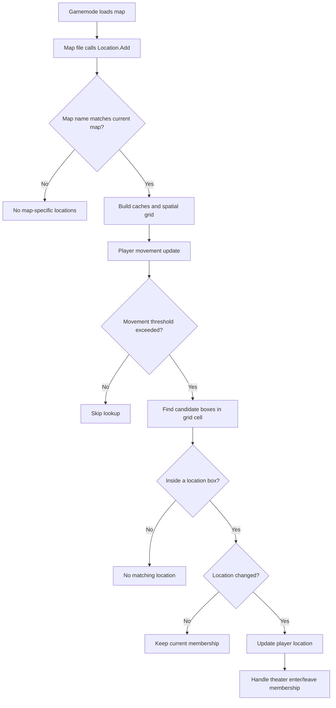

# Location system

The Location system defines named areas of a map and determines which area contains each player. Theater locations connect those areas to theater instances. Without valid location data, fixed theaters on a map cannot be initialized correctly.

## Registration and lookup

Map files register locations through `Location.Add`:

```lua
Location.Add("map_name_here", {
    ["Lobby"] = {
        Min = Vector(x1, y1, z1),
        Max = Vector(x2, y2, z2),
    },
    ["Private Theater #1"] = {
        Min = Vector(...),
        Max = Vector(...),
        Theater = {
            -- Theater definition
        },
    },
})
```

The map name must match `game.GetMap()` (case-insensitive). Each location has a readable name and an axis-aligned bounding box defined by `Min` and `Max`.

Map-specific files are stored at:

```text
cinema_modded/gamemode/maps/<mapname>.lua
```

## Theater definition

A location can define a theater using a `Theater` table:

```lua
Theater = {
    Name = "Private Theater 1",
    Flags = THEATER_PRIVATE,
    Pos = Vector(...),       -- screen origin/top-left
    Ang = Angle(0, 180, 0),  -- screen orientation
    Width = 396,
    Height = 192,
    ThumbInfo = {            -- optional thumbnail
        Pos = Vector(...),
        Ang = Angle(0, 0, 0),
    },
}
```

| Flag | Purpose |
|---|---|
| `THEATER_REPLICATED` | Public theater replicated to players |
| `THEATER_PRIVATE` | Private/ownable theater; can be rented when renting is configured |
| `THEATER_PRIVILEGED` | Theater with restricted access rules |
| `THEATER_NONE` | Theater that is not listed like a normal public theater |

Use the definitions and existing map files as the source of truth when choosing flags and geometry.

## How player lookup works

1. The current map's location data is registered.
2. The module precomputes index/name caches and a 2D spatial grid.
3. Player movement checks can be skipped when the player has moved less than the configured internal threshold.
4. Candidate location boxes in the player's grid cell are tested against the player's position.
5. The player's location index is updated; theater enter/leave behavior follows the location change.

The spatial grid currently uses 512-unit cells. The cell size and movement threshold are implementation details, not server ConVars.


## Location lookup flow

The current map's location data is registered first. The module builds lookup caches and a spatial grid, then tests candidate boxes as players move.



## Debugging

- `cinema_debug_locations 1` – draw location bounds and names on the client.
- `cinema_debug_grid 1` – visualize nearby spatial-grid cells.
- `cinema_location_debug` – print server-side cache and grid diagnostics (superadmin).
- `cinema_location_debug_reset` – reset diagnostic counters (superadmin).
- `cinema_loc_start`, `cinema_loc_end`, and `cinema_loc_vector` – create location snippets (admin).

See [Debug commands](debug-commands.md) and [Creating custom maps](creating-custom-maps.md).

## Mapping notes

- Keep boxes tight and avoid overlaps where possible.
- Ensure each theater location has a valid theater definition or corresponding Hammer entity setup.
- When changing location files, reload the map or restart the server so the data is registered again.

## Related pages

- [Creating custom maps](creating-custom-maps.md)
- [Debug commands](debug-commands.md)
- [Commands](commands.md)
