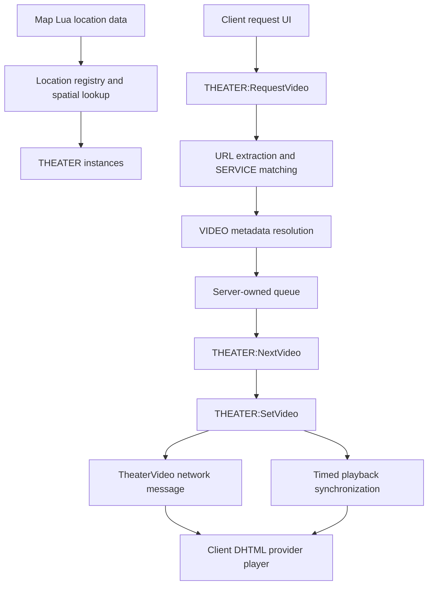

# Theater architecture

This page outlines the core runtime objects and how the server, client, and embedded browser cooperate.

## Main components

| Component | Location | Responsibility |
|---|---|---|
| `Location` | `gamemode/modules/location/` | Map areas and player location lookup |
| `THEATER` | `gamemode/modules/theater/sh_theater.lua` | Theater state, queue, playback, ownership |
| `VIDEO` | `gamemode/modules/theater/sh_video.lua` | A queued or playing media item |
| `SERVICE` | `gamemode/modules/theater/services/` | URL matching, metadata, and provider playback |
| Scoreboard | `gamemode/modules/scoreboard/` | Queue, request, owner/admin, and settings UI |
| Rent | `gamemode/modules/rent/` | Private-theater rent lifecycle and currency providers |

## Runtime overview

The server owns theater state and queue decisions. Clients provide the UI and embedded media player; they receive the active video and playback state over theater network messages.

## Server lifecycle

1. Map-specific Lua registers location boxes.
2. The theater module creates theater instances for locations with theater data.
3. Player location changes add/remove players from theater instances.
4. A request is matched to a registered media service.
5. Metadata is resolved and a VIDEO is created/queued.
6. The server owns authoritative queue and playback state and replicates updates to relevant clients.

## Core objects

### THEATER

A theater instance owns its location identity, geometry, flags, player list, queue, current video, skip votes, and related state. Methods include request, skip, seek, pause, reset, and queue-lock operations. Private theaters may be extended by the rent module.

### VIDEO

A VIDEO represents a media item. It stores the service type and service-specific data, display metadata such as title/duration/thumbnail, playback timing, requester/owner information, and vote state.

### SERVICE

A SERVICE matches supported URLs, extracts provider-specific identifiers, retrieves metadata, and loads the client-side player. Service implementations live in `gamemode/modules/theater/services/`.

## Networking and authority

- The server is authoritative for theater membership, queue changes, permissions, and rental state.
- Clients request actions; the server validates them before applying state changes.
- Theater state and queue snapshots are sent to players who need them.
- The rent module adds networking for rental status and player filters.

When extending the protocol, follow existing module conventions and validate all client-provided data server-side. See [AGENTS.md](../AGENTS.md).

## Embedded browser flow

1. The client theater panel creates a DHTML surface.
2. A service opens its provider page or injects the required player code.
3. The provider exposes `window.cinema_controller` and signals `exTheater.controllerReady()`.
4. The Cinema JavaScript bridge exposes playback controls such as volume, seek, pause, and synchronization.

The `cinema_url` ConVar selects the base URL for hosted Cinema HTML pages. Do not change it unless you host a compatible copy of the player frontend.

## Extension points

| Goal | Where to look |
|---|---|
| Add a media provider | `services/` – see [Custom video service](custom-video-service.md) |
| Change theater state or queue behavior | `sh_theater.lua` and related theater module files |
| Add rental behavior | `modules/rent/` – see [Theater renting](theater-renting.md) |
| Add currency integration | `modules/rent/sh_currency.lua` |
| Add chair models | `modules/seats/sh_seats.lua` – see [Seats](seats.md) |
| Add a language | `gamemode/i18n/languages/` – see [Translations](translations.md) |

## Related pages

- [Custom video service](custom-video-service.md)
- [Location system](location-system.md)
- [Development](development.md)
- [Commands](commands.md)
