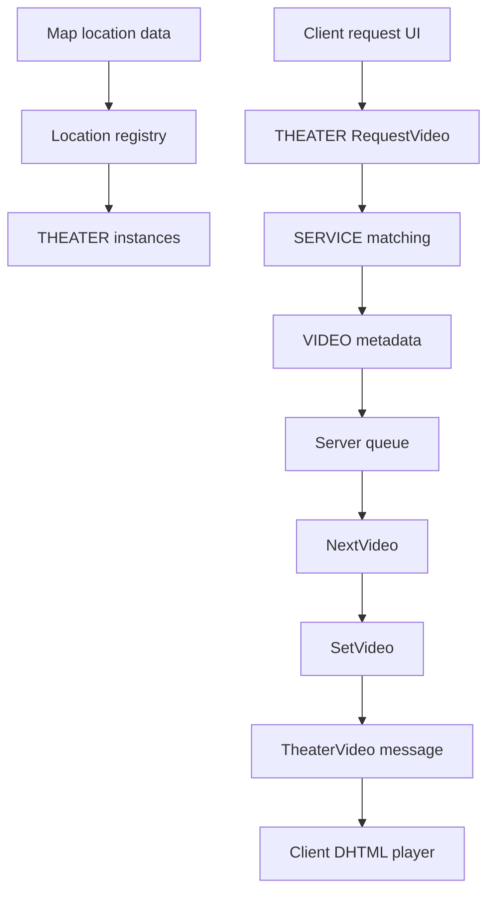

# Theater architecture

This page outlines the core runtime objects and how the server, client, and embedded browser cooperate.

## Runtime overview

The server owns theater state and queue decisions. Clients provide the UI and embedded media player.

