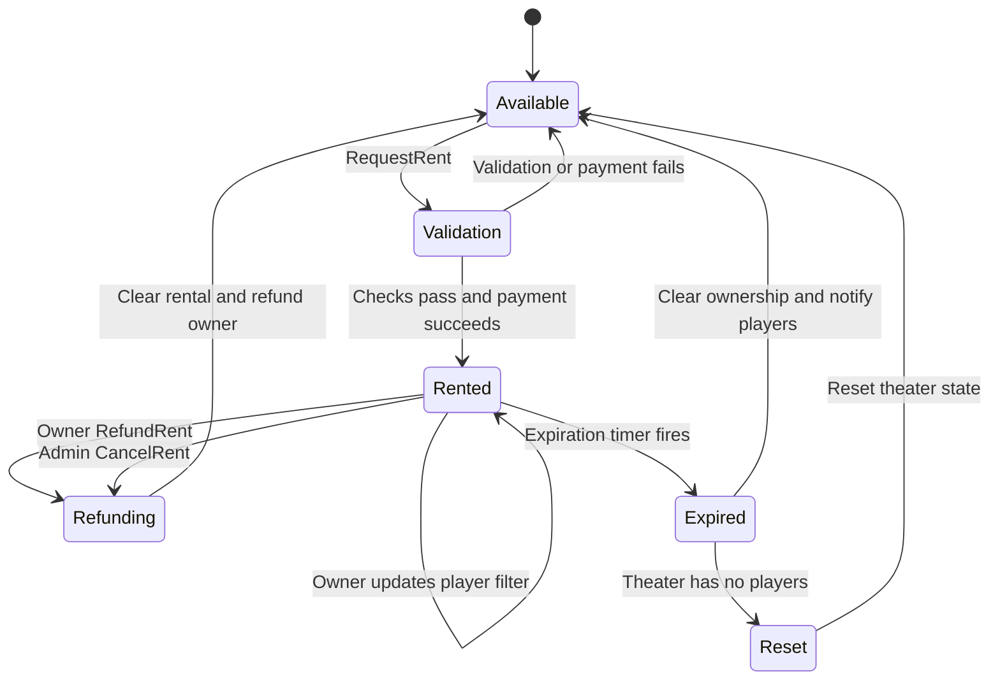

# Theater renting

Private theaters can be rented for a limited time using an installed point currency provider. The renter becomes the theater owner for the rental period; ownership is tracked by SteamID so it can survive disconnects.

## Player workflow

1. Enter a private theater.
2. Open the scoreboard queue panel.
3. Select **Rent Theater**, choose a duration, and confirm.
4. The cost is the selected number of minutes multiplied by `cinema_rent_cost_per_minute`.

While renting, the owner panel provides controls to extend the rental, refund remaining time, manage the player whitelist/blacklist, and toggle the vote-skip lock.

Admins can cancel an active rental. Remaining value is refunded to the owner; if the owner is offline, the refund is queued for their next connection.


## Rental lifecycle

A rental is created only after theater, owner, duration, and currency checks pass. Expiry clears ownership; an empty theater is then reset.



Refunds use remaining time rounded up to whole minutes. If the owner is offline during an admin cancellation, the refund is queued by SteamID for their next connection. Normal expiration does not issue a refund.

## Requirements and currency providers

The location must define a private theater (`THEATER_PRIVATE`). The rent module includes providers for:

- PointShop 1 (`pointshop1`)
- PointShop 2 (`pointshop2`), using standard or premium points

The provider is auto-detected unless `cinema_rent_currency` is set to a provider ID. If no supported provider is available, rentals cannot be charged.

## ConVars

| ConVar | Default | Realm | Description |
|---|---:|---|---|
| `cinema_rent_cost_per_minute` | `10` | Shared | Points charged per minute |
| `cinema_rent_min_time` | `1` | Shared | Minimum rental duration in minutes |
| `cinema_rent_max_time` | `300` | Shared | Maximum rental duration in minutes |
| `cinema_rent_ps2_premium` | `0` | Shared | Use PointShop 2 premium points |
| `cinema_rent_currency` | Empty | Shared | Force `pointshop1` or `pointshop2`; empty auto-detects |
| `cinema_rent_prevent_unrented` | `0` | Server | Prevent activity in private theaters that are not rented |
| `cinema_rent_admins_ignore_filter` | `1` | Server | Let admins bypass renter filters |
| `cinema_rent_admins_alert_filtered` | `1` | Server | Notify admins when a filter would block them |
| `cinema_rent_super_alert_admin_filtered` | `1` | Server | Notify superadmins when an admin enters a filtered theater |

## Rental behavior

- Rental ownership is stored by SteamID and is not ended by a disconnect.
- Extending a rental charges for the additional time.
- Refunds are calculated from remaining time and rounded up to whole minutes.
- Offline-owner refunds are applied when the owner reconnects.
- Player filters support whitelist and blacklist behavior; admin bypass and alert behavior are configurable.

## Module layout

```text
cinema_modded/gamemode/modules/rent/
  sh_config.lua      ConVars and accessors
  sh_currency.lua    Currency providers
  sh_rent.lua        Shared helpers
  sv_theater.lua     Theater class extensions and rental lifecycle
  sv_net.lua         Networking and rate limits
  sv_hooks.lua       Enter, queue, and filter hooks
  sv_player.lua      Player connect and pending refunds
  cl_rent.lua        Client rental state
  cl_windows.lua     Rental and filter UI
```

## Related pages

- [Configuration](configuration.md)
- [Commands](commands.md)
- [Development](development.md)
